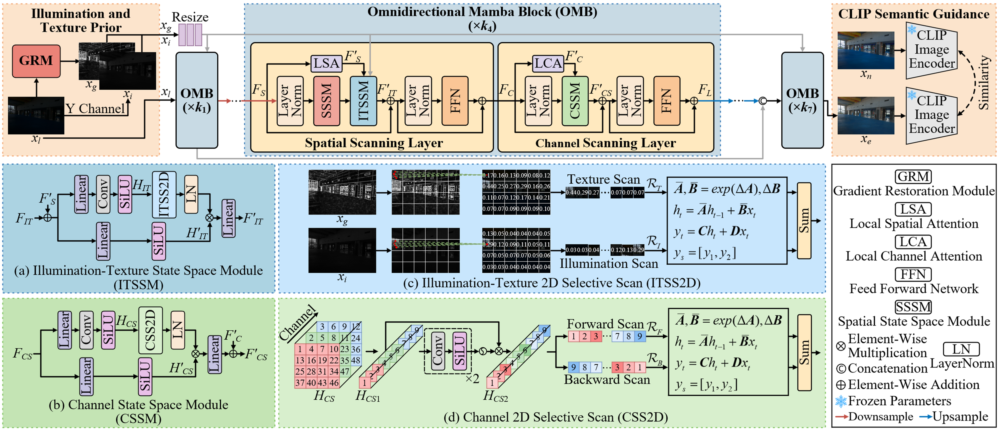
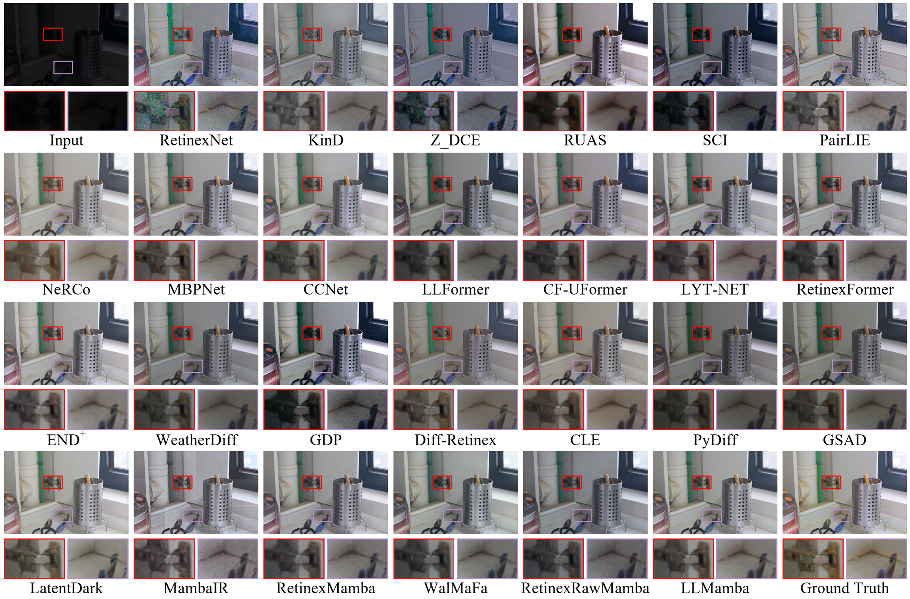

# LLMamba

### LLMamba: Degradation-Aware Omnidirectional Scanning for Low-Light Image Enhancement with Semantic Guidance


### 1. Prepare the dataset.

The dataset should be placed as follows:

```
|--LLMamba
|    |--data     
|    |    |--LOLv1
|    |    |    |--Train
|    |    |    |    |--high
|    |    |    |    |--low
|    |    |    |--Test
|    |    |    |    |--high
|    |    |    |    |--low
|    |    |--LOLv2_real
|    |    |    |--Train
|    |    |    |    |--high
|    |    |    |    |--low
|    |    |    |--Test
|    |    |    |    |--high
|    |    |    |    |--low
......
```

### 2. Train

Taking LOL-v1 dataset as an example:

1. Modify the configuration file `basicsr/LLMamba_LOL_v1.yml`

2. Run the training script:
```bash
python basicsr/train.py -opt basicsr/LLMamba_LOL_v1.yml
```

### 3. Test

Taking LOL-v1 dataset as an example: 

1. Modify the configuration file `basicsr/LLMamba_LOL_v1.yml`

2. Run the test script:
```bash
python basicsr/test.py -opt basicsr/LLMamba_LOL_v1.yml
```

### Some Results


---
#### --- Thanks for your interest! --- ####
