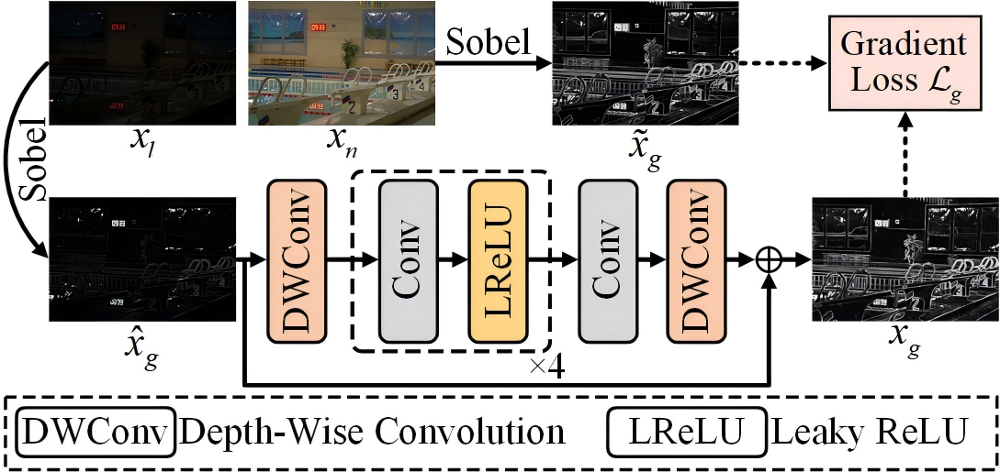
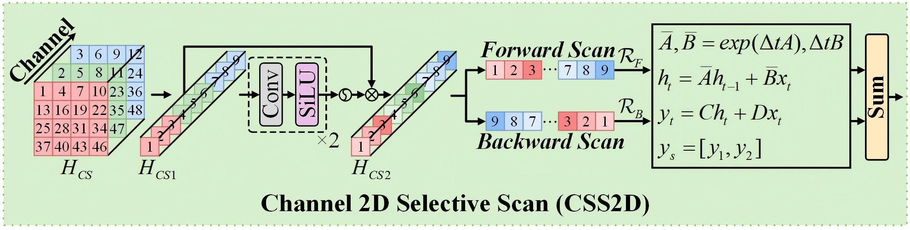
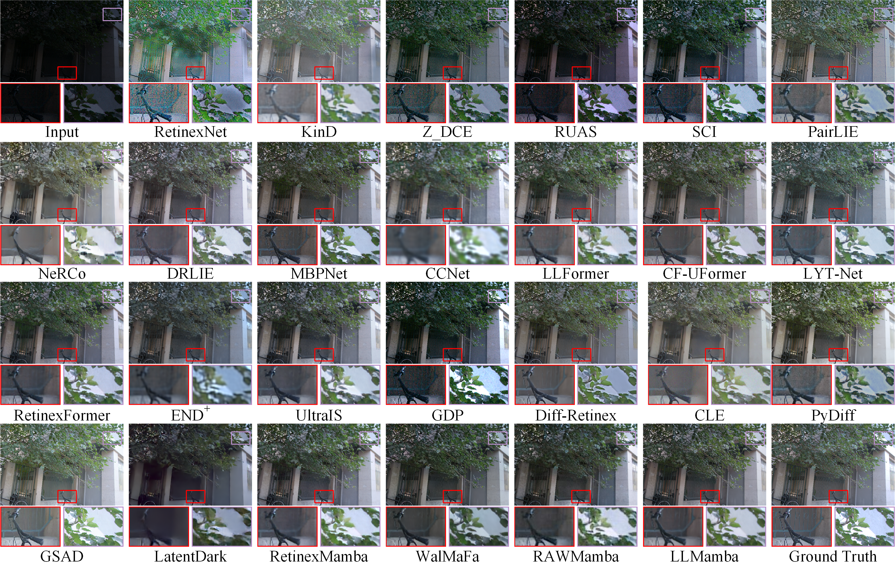
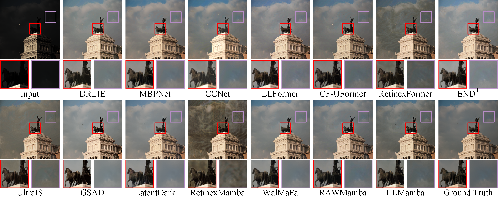
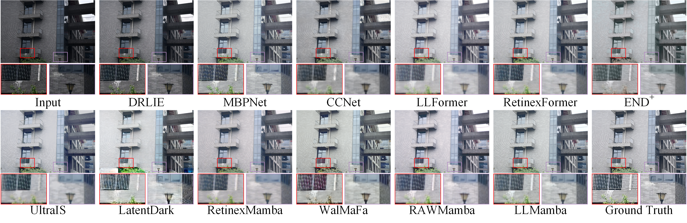
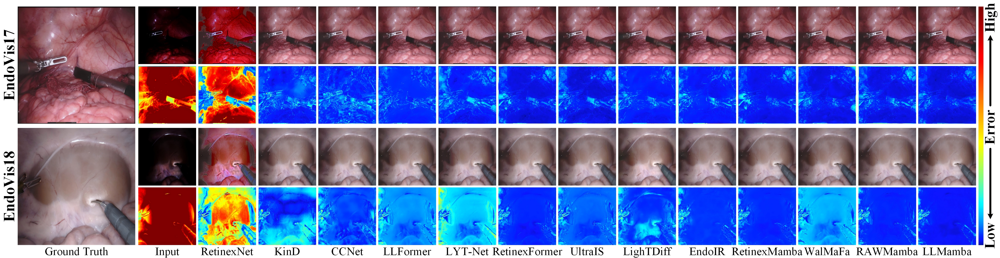
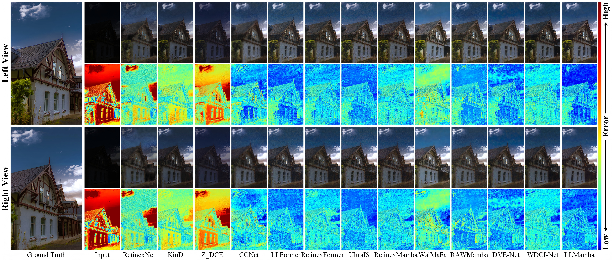

&nbsp;

<div align="center">

# [TNNLS 2026] LLMamba: Prior-Guided Mamba with Semantic Constraints for Low-Light Image Enhancement

Renzhi Hu, Li Li<sup>†</sup>, Zhouyan He, Wujie Zhou, Gangyi Jiang, Haiyong Xu, Ting Luo<sup>†</sup>

<sup>†</sup> Corresponding authors

</div>

&nbsp;

## Proposed LLMamba ⚙

Low-light images suffer from multi-level degradations: insufficient illumination, noise, texture loss, and color distortion. LLMamba is a prior-guided Mamba with semantic constraints that handles them in three dimensions:

- **Spatial.** The illumination-texture spatial state space module (ITSSSM) uses a texture prior to modulate the discretization step size of the SSM (TMSS2D): smaller in flat regions to suppress noise, larger in textured regions to preserve details. The illumination and texture priors also reorder the scan (ITSS2D), so that distant pixels with similar illumination and texture are correlated.
- **Channel.** The channel state space module (CSSM) scans the channels in both directions (CSS2D) to capture inter-channel correlations and degradation disparities, which suppresses color distortion.
- **Semantic.** CLIP aligns the enhanced and normal-light images in the semantic space, which keeps object edges clear.

<details open>
<summary><b>LLMamba pipeline:</b></summary>


</details>

<details>
<summary><b>Gradient Restoration Module (GRM):</b></summary>



</details>

<details>
<summary><b>Channel 2D Selective Scan (CSS2D):</b></summary>



</details>

## Visual Comparison 🖼

<details>
<summary><b>LOL-v1:</b></summary>


</details>

<details>
<summary><b>LOL-v2-real:</b></summary>



</details>

<details>
<summary><b>LOL-v2-syn:</b></summary>



</details>

<details>
<summary><b>LSRW:</b></summary>



</details>

<details>
<summary><b>Low-light endoscopic images (EndoVis17 and EndoVis18):</b></summary>



</details>

<details>
<summary><b>Low-light stereo images (Flickr1024):</b></summary>



</details>

## Weights and Results 🧾

All the weights that we trained on different datasets are available at [Baidu Pan](https://pan.baidu.com/s/1sZa2yYpuy4d8Ap2zleA99Q?pwd=6kn3) (code: `6kn3`). The enhanced results of LLMamba and all compared methods on all test sets are available at [Baidu Pan](https://pan.baidu.com/s/1sZa2yYpuy4d8Ap2zleA99Q?pwd=6kn3) (code: `6kn3`). For the compared methods, we use their official pretrained weights for the corresponding dataset when they are released, and retrain the other methods with the settings recommended in their papers.

The metrics below are the mean ± standard deviation over three random seeds, as reported in the paper. The released weights come from one of these runs, so their scores can differ slightly from the means.

<details open>
<summary><b>LOL-v1, LOL-v2-real, LOL-v2-syn, LSRW, EndoVis17, and EndoVis18:</b></summary>

| Dataset     | PSNR↑           | SSIM↑          | LPIPS↓         | Config                    | Weights          |
| ----------- | --------------- | -------------- | -------------- | ------------------------- | ---------------- |
| LOL-v1      | 25.075 ± 0.0789 | 0.862 ± 0.0018 | 0.116 ± 0.0025 | `LLMamba_LOL_v1.yml`      | `LOLv1.pth`      |
| LOL-v2-real | 22.655 ± 0.2242 | 0.869 ± 0.0009 | 0.143 ± 0.0028 | `LLMamba_LOL_v2_real.yml` | `LOLv2_real.pth` |
| LOL-v2-syn  | 26.047 ± 0.0275 | 0.943 ± 0.0015 | 0.045 ± 0.0017 | `LLMamba_LOL_v2_syn.yml`  | `LOLv2_syn.pth`  |
| LSRW        | 19.646 ± 0.0439 | 0.593 ± 0.0005 | 0.432 ± 0.0186 | `LLMamba_LSRW.yml`        | `LSRW.pth`       |
| EndoVis17   | 36.974 ± 0.0460 | 0.972 ± 0.0001 | 0.024 ± 0.0002 | `LLMamba_Endovis17.yml`   | `Endovis17.pth`  |
| EndoVis18   | 34.804 ± 0.1678 | 0.967 ± 0.0002 | 0.035 ± 0.0001 | `LLMamba_Endovis18.yml`   | `Endovis18.pth`  |

</details>

<details>
<summary><b>Low-light stereo images (Flickr1024, KITTI 2012&2015, and Middlebury):</b></summary>

One model (`Stereo_image.pth`, config `LLMamba_Stereo_image.yml`) is trained on the three datasets together and tested on each of them.

| Test set        | View  | PSNR↑           | SSIM↑          | LPIPS↓         |
| --------------- | ----- | --------------- | -------------- | -------------- |
| Flickr1024      | Left  | 25.826 ± 0.0751 | 0.853 ± 0.0027 | 0.073 ± 0.0010 |
| Flickr1024      | Right | 25.845 ± 0.1481 | 0.854 ± 0.0025 | 0.074 ± 0.0012 |
| KITTI 2012&2015 | Left  | 26.208 ± 0.1760 | 0.877 ± 0.0030 | 0.075 ± 0.0026 |
| KITTI 2012&2015 | Right | 26.302 ± 0.1041 | 0.883 ± 0.0027 | 0.075 ± 0.0024 |
| Middlebury      | Left  | 25.322 ± 0.7029 | 0.923 ± 0.0055 | 0.032 ± 0.0006 |
| Middlebury      | Right | 25.143 ± 0.6018 | 0.922 ± 0.0070 | 0.034 ± 0.0010 |

</details>

## 1. Get Started 🌑

### Dependencies and Installation

- Linux or WSL2 with an NVIDIA GPU (the selective-scan kernel of `mamba_ssm` needs CUDA)
- We tested the code with PyTorch 2.10 + CUDA 12.8 on an NVIDIA RTX 5090.

(1) Create Conda Environment

```bash
conda create --name LLMamba python=3.10
conda activate LLMamba
```

(2) Clone Repo

```bash
git clone https://github.com/RenzhiHu111/LLMamba.git
cd LLMamba
```

(3) Install Dependencies

```bash
# PyTorch: choose the command that matches your CUDA version at https://pytorch.org
pip install torch torchvision --index-url https://download.pytorch.org/whl/cu128
pip install opencv-python scikit-image scipy einops timm thop ftfy regex tqdm pyyaml lmdb tensorboard
# selective-scan kernel; if no prebuilt wheel matches your CUDA/PyTorch, see https://github.com/state-spaces/mamba
pip install mamba-ssm --no-build-isolation
# install basicsr in development mode
python setup.py develop --no_cuda_ext
```

The CLIP loss uses `ViT-B-32.pt` and `RN101.pt`. The code loads them from `basicsr/clip_model/` in both training and testing. You can download them from [Baidu Pan](https://pan.baidu.com/s/1sZa2yYpuy4d8Ap2zleA99Q?pwd=6kn3) (code: `6kn3`) and put them in `basicsr/clip_model/`; if they are missing, they are downloaded from OpenAI automatically on the first run.

### Data Preparation

| Dataset | Train / test pairs | Folder in `basicsr/data` | Download |
| ------- | ------------------ | ------------------------ | -------- |
| LOL-v1 | 485 / 15 | `LOLv1` | [RetinexNet](https://daooshee.github.io/BMVC2018website/) |
| LOL-v2-real | 689 / 100 | `LOLv2_real` | [Retinexformer](https://github.com/caiyuanhao1998/Retinexformer#2-prepare-dataset) |
| LOL-v2-syn | 900 / 100 | `LOLv2_syn` | [Retinexformer](https://github.com/caiyuanhao1998/Retinexformer#2-prepare-dataset) |
| LSRW (Huawei + Nikon) | 5,600 / 50 | `LSRW` | [R2RNet](https://github.com/JianghaiSCU/R2RNet) |
| EndoVis17 (low-light) | 1,800 / 1,200 | `Endovis17` | [LighTDiff](https://github.com/DavisMeee/LighTDiff) |
| EndoVis18 (low-light) | 1,639 / 596 | `Endovis18` | [LighTDiff](https://github.com/DavisMeee/LighTDiff) |
| Low-light stereo images (Flickr1024 + KITTI 2012&2015 + Middlebury) | 1,720 / 314 | `Stereo_image` | [Baidu Pan](https://pan.baidu.com/s/1sZa2yYpuy4d8Ap2zleA99Q?pwd=6kn3) (code: `6kn3`) |

LOL-v2-real and LOL-v2-syn come in the same LOL-v2 download: put `Real_captured` in `LOLv2_real` and `Synthetic` in `LOLv2_syn`, and rename `Train`/`Test` to `train`/`test` and `Normal`/`Low` to `high`/`low`. For LOL-v1, `our485` is the training set and `eval15` the test set.

Then put them in `basicsr/data` as follows (the paths are set by `dataroot_gt` and `dataroot_lq` in each config):

<details> <summary>datasets (click to expand)</summary>

```
basicsr/data
├── LOLv1
│   ├── train
│   │   ├── high
│   │   └── low
│   └── test
│       ├── high
│       └── low
├── LOLv2_real
│   ├── train
│   │   ├── high
│   │   └── low
│   └── test
│       ├── high
│       └── low
├── LOLv2_syn
│   ├── train
│   │   ├── high
│   │   └── low
│   └── test
│       ├── high
│       └── low
├── LSRW
│   ├── train
│   │   ├── high
│   │   └── low
│   └── test
│       ├── high
│       └── low
├── Endovis17
│   ├── train
│   │   ├── high
│   │   └── low
│   └── test
│       ├── high
│       └── low
├── Endovis18
│   ├── train
│   │   ├── high
│   │   └── low
│   └── test
│       ├── high
│       └── low
└── Stereo_image
    ├── train
    │   ├── high
    │   └── low
    └── test
        ├── high
        └── low
```

`high` holds the normal-light images and `low` holds the low-light images.

</details>

## 2. Testing 🌒

Download our weights from [Baidu Pan](https://pan.baidu.com/s/1sZa2yYpuy4d8Ap2zleA99Q?pwd=6kn3) (code: `6kn3`) and put them in `basicsr/pretrained`:

<details> <summary>weights (click to expand)</summary>

```
basicsr/pretrained
├── LOLv1.pth
├── LOLv2_real.pth
├── LOLv2_syn.pth
├── LSRW.pth
├── Endovis17.pth
├── Endovis18.pth
└── Stereo_image.pth
```

</details>

(1) In the config of the dataset you want to test (for example `basicsr/LLMamba_LOL_v1.yml`), set the path of the weights:

```yaml
path:
  pretrain_network_g: pretrained/LOLv1.pth
  strict_load_g: true
  resume_state: ~
```

(2) Run the test in the `basicsr` folder:

```bash
cd basicsr
python test.py --opt LLMamba_LOL_v1.yml
```

- The PSNR on the test set is printed as `Validation ValSet` in the log. `test.py` also evaluates the training images listed in the config, printed as `Validation TrainSet`.
- The log and the enhanced images are saved to `results/Enhancement_LLMamba_LOL_v1/`; the enhanced test images are in `visualization/ValSet/`.
- `test.py` also reports the number of parameters and FLOPs (computed with `thop`).
- For the other datasets, use the config and weights listed in [Weights and Results](#weights-and-results-).
- `test.py` and `train.py` run on GPU 0; to use another GPU, change `CUDA_VISIBLE_DEVICES` at the top of the two files.

## 3. Training 🌓

Keep `pretrain_network_g: ~` in the config to train from scratch, then run in the `basicsr` folder:

```bash
cd basicsr
python train.py --opt LLMamba_LOL_v1.yml
```

- All settings are in the configs. Following the paper, we train for 150k iterations with a batch size of 8 on 128×128 patches, using Adam (β1 = 0.9, β2 = 0.999) with an initial learning rate of 2×10⁻⁴ and cosine annealing.
- The training losses are set in `pixel_opt`: image loss (`MSELoss`), color loss (`ColorLoss`), SSIM loss (`SSIMLoss`), gradient loss (`MSELoss1`), and CLIP loss (`L_clip_MSE`).
- Checkpoints, training states, and logs are saved to `experiments/Enhancement_LLMamba_LOL_v1/`, and TensorBoard logs to `basicsr/tb_logger/`.

## 4. Contacts 🌔

If you have any questions, please contact us or submit an issue to the repository!

Renzhi Hu (256050153@hdu.edu.cn)

## 5. Citation 🌕

If you find our work useful for your research, please cite our paper

<!-- TODO: add volume, number, pages and DOI once the paper is published -->

```
@article{hu2026llmamba,
  title={LLMamba: Prior-Guided Mamba with Semantic Constraints for Low-Light Image Enhancement},
  author={Hu, Renzhi and Li, Li and He, Zhouyan and Zhou, Wujie and Jiang, Gangyi and Xu, Haiyong and Luo, Ting},
  journal={IEEE Transactions on Neural Networks and Learning Systems},
  year={2026}
}
```

## 6. Acknowledgements 🌖

This code is built on [RetinexMamba](https://github.com/YhuoyuH/RetinexMamba), [Retinexformer](https://github.com/caiyuanhao1998/Retinexformer), and [LatentDark](https://github.com/RenzhiHu111/LatentDark). We thank the authors for sharing their code.

This project is released under the [MIT License](LICENSE).
